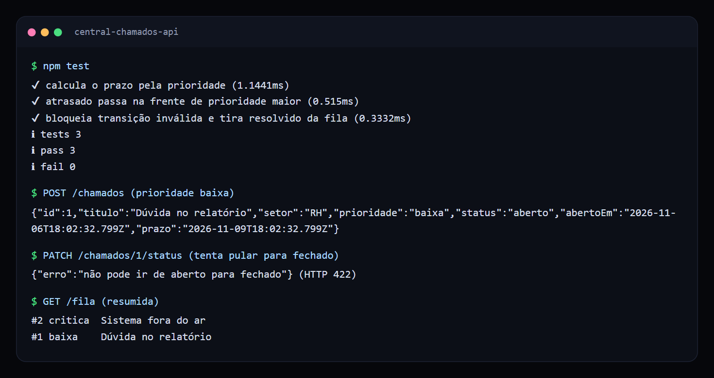
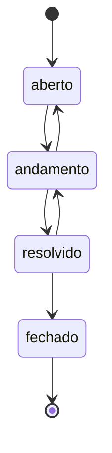

# API de central de chamados

API para abrir chamados entre setores, com prazo de atendimento (SLA) calculado pela prioridade e fila inteligente.

 

## Veja funcionando



*Testes e chamadas reais: transição inválida recusada e chamado crítico na frente da fila.*

## O problema

Pedidos internos que chegam por e-mail e mensagem se perdem, e ninguém sabe o que está atrasado. Uma central de chamados precisa deixar claro o que atender agora e impedir que um chamado pule etapas.

## O que ela faz

- Calcula o prazo de cada chamado pela prioridade.
- Ordena a fila: atrasados primeiro, depois prioridade, depois prazo mais próximo.
- Controla o ciclo de vida com transições válidas.
- Tira da fila o que já foi resolvido.

| Prioridade | Prazo |
| --- | --- |
| Crítica | 4 horas |
| Alta | 8 horas |
| Média | 24 horas |
| Baixa | 72 horas |

## Ciclo de vida



## Endpoints

| Método | Rota | Descrição |
| --- | --- | --- |
| `GET` | `/fila` | Lista a fila ordenada |
| `POST` | `/chamados` | Abre um chamado |
| `PATCH` | `/chamados/:id/status` | Muda o status (`422` se a transição for inválida) |

## Decisões técnicas

| Decisão | Motivo |
| --- | --- |
| Atrasado vem antes da prioridade | Um chamado de baixa prioridade não pode ficar parado para sempre. |
| Transições em uma tabela | A regra fica visível em um só lugar e é fácil de mudar. |
| Horário recebido por parâmetro | Os testes de prazo não dependem do relógio real. |

## Como rodar

Requer Node.js 24 ou superior.

```bash
npm test
npm start
```

```bash
curl -X POST localhost:3000/chamados -d '{"titulo":"Impressora parada","setor":"RH","prioridade":"alta"}'
curl localhost:3000/fila
```

## Próximos passos

- Contar o prazo apenas em horário comercial.
- Persistir em banco de dados.
- Notificar o responsável perto do vencimento.

## Sobre este projeto

Projeto de demonstração, com dados e empresas fictícios, criado para mostrar a abordagem técnica de forma simples.

## Autor

**Luiz Renato Carvalho**, Engenheiro de Software e IA · [luizrenato.dev](https://www.luizrenato.dev) · [LinkedIn](https://linkedin.com/in/luizrenatodc)
